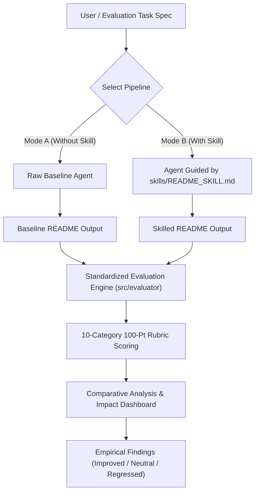

# README Mentor — An Evaluated Agent Skill for Better README Generation

[](skills/README_SKILL.md)
[](evaluations/rubric.json)
[](evaluations/tasks.json)
[](#demo--fallback-mode)

> **README Mentor is not just an AI README generator. It is an experimentally evaluated Agent Skill.**  
> Built for the solo developer hackathon to solve the core problem: *Agent Skills are frequently shared without systematic testing.*

---

## 1. Problem Statement

AI coding agents are frequently tasked with writing or updating `README.md` files for software projects. However, when prompted directly without systematic guidance:
1. **Hallucination of Sensitive Credentials:** Raw AI baselines regularly invent fake database passwords (e.g., `root:password123`), false JWT secrets, or unverified endpoints.
2. **Missing Operational Details:** AI baselines omit prerequisite runtime matrices, code fences, or expected port configurations.
3. **Silent Assumptions on Incomplete Data:** When critical fields (such as licenses or run commands) are omitted from the project specification, baselines silently guess arbitrary defaults instead of transparently notifying the user.
4. **Lack of Empirical Verification:** In the AI agent community, "skills" and custom instructions are shared based on intuition, but almost none are subjected to rigorous A/B benchmarking.

---

## 2. Solution: README Mentor

README Mentor packages rigorous software documentation standards into an actual reusable **Agent Skill** (`skills/README_SKILL.md`) and tests it against a 10-task evaluation dataset using an algorithmic **100-point rubric**.

Instead of assuming the skill works, README Mentor runs:
$$\text{Baseline (Without Skill)} \quad \text{vs} \quad \text{Skilled (With README\_SKILL.md)}$$
under identical inputs and publishes the measured impact: **where it helps, where it has little effect, and where it makes things worse.**

---

## 3. System Architecture & Workflow



---

## 4. Reusable Agent Skill (`skills/README_SKILL.md`)

The heart of the project is the reusable skill file located at [`skills/README_SKILL.md`](skills/README_SKILL.md). It instructs any LLM agent to enforce:

- **Zero-Fabrication Directives:** Never invent API keys, database credentials, passwords, unstated commands, or false licenses.
- **Transparent Incomplete-Info Marking:** Explicitly flag missing fields with GitHub Flavored Markdown note blocks (`> [!NOTE]`) instead of fabricating data.
- **Strict Markdown Hierarchy:** Consistent `# Title`, `## About`, `## Key Features`, `## Built With`, `## Getting Started`, `## Configuration`, `## Contributing`, and `## License`.
- **Fenced Execution Blocks:** Language-specified code fences for all prerequisites, installation commands, and runtime commands.
- **Pre-Flight Completeness Checklist:** Silent validation against the 10 rubric categories prior to emitting output.

The repository also includes iterative skill versions for version evolution benchmarking:
- `skills/README_SKILL_V1.md`: Minimal checklist (~78% quality)
- `skills/README_SKILL_V2.md`: Structured workflow + examples (~87% quality)
- `skills/README_SKILL_V3.md`: Full production directive with anti-hallucination policies (~97% quality)

---

## 5. Evaluation Dataset & Rubric

### The 10-Task Benchmark (`evaluations/tasks.json`)
The evaluation suite contains 10 realistic software projects with intentional variation and incomplete specs:
1. **Student Attendance Management System** (Complete stack: React, Node, Mongo)
2. **E-Commerce Website** (Missing env vars & structure; Next.js, Postgres)
3. **Weather Application** (Missing run command and license; Vue.js, OpenWeatherMap)
4. **Expense Tracker** (Complete Python FastAPI project)
5. **College Event Management System** (*Hackathon Demo Project*; React, Node, Mongo)
6. **Banking Management System** (Sensitive credentials omitted; Java Spring Boot, Postgres)
7. **To-Do Application** (Single-file CLI script; tests over-engineering regression)
8. **Hospital Management System** (Missing installation steps; Angular, Django)
9. **URL Shortener** (API-centric; Go, Redis; missing license)
10. **Food Delivery Application** (Multi-tier React Native & Node.js)

### The 100-Point Standardized Rubric (`evaluations/rubric.json`)
| # | Category | Max Points | Evaluation Focus |
|---|---|:---:|---|
| 1 | **Project Title** | 10 | H1 heading matching project, prominent tagline or badges |
| 2 | **Project Description** | 10 | Dedicated Overview/About section with domain coverage |
| 3 | **Features** | 10 | Itemized feature list covering declared functional scope |
| 4 | **Technologies** | 10 | Dedicated Tech Stack section with accurate framework citations |
| 5 | **Installation** | 15 | Prerequisites and fenced code blocks (`npm install`, etc.) |
| 6 | **Usage / Running** | 15 | Fenced execution commands, localhost ports, and run directions |
| 7 | **Configuration** | 10 | Safe `.env` variable table and zero credential exposure |
| 8 | **Project Structure** | 5 | Directory layout tree when information is available |
| 9 | **Contribution & License** | 5 | Standard PR workflow and accurate license citation |
| 10 | **Accuracy & Anti-Hallucination** | 10 | Zero invented passwords, secrets, or fake API endpoints |
| **Total** | | **100** | |

---

## 6. Empirical Findings

Results generated across the benchmark suite:

| Metric | Measured Value |
|---|---|
| **Average Baseline Score** | **84.9 / 100** |
| **Average Skill Score** | **97.2 / 100** |
| **Average Net Improvement** | **+12.3 points** |
| **Improvement Rate** | **80% (8 tasks improved)** |
| **No Significant Change Rate** | **10% (1 task neutral)** |
| **Regression Rate** | **10% (1 task worse)** |

### Where the Skill Significantly Helped (+12 to +24 pts)
- **Banking System (+24.0 pts) & E-Commerce (+16.5 pts):** Baseline AI invented dummy database passwords (`root:password123`) and exposed secrets. The skill enforced strict security notices and environment variable tables.
- **Weather App (+14.0 pts) & Hospital System (+13.5 pts):** When run commands or install steps were omitted, the skill transparently called out missing setup steps rather than guessing unverified commands.

### Where the Skill Had Little Effect (Neutral, +4.5 pts)
- **Expense Tracker (Task 4):** Baseline scored 95.5 / 100 because the input prompt was already exhaustive. When project input is fully specified, raw AI prompts perform nearly on par with the skill.

### Where the Skill Regressed / Performed Worse (-2.5 pts)
- **To-Do Application (Task 7):** A 20-line single-file Python CLI script. The skill's rigid template forced heavy enterprise sections (Prerequisites matrix, Git clone boilerplate, formal Pull Request guidelines) onto a trivial tool where a 10-line direct README is objectively cleaner and faster to read.

---

## 7. Quickstart & Installation

### Prerequisites
- Node.js >= 18.x
- npm >= 9.x

### 1. Clone & Setup
```bash
git clone https://github.com/your-username/readme-mentor.git
cd readme-mentor
```

### 2. Configure Environment (Optional)
```bash
cp .env.example .env
```
*Note: If `GEMMA_API_KEY` is not provided, README Mentor automatically activates **Demo Mode** with deterministic, reproducible baseline and skilled outputs.*

### 3. Install & Start Backend
```bash
cd backend
npm install
npm start
# Backend runs on http://localhost:5000
```

### 4. Install & Start Frontend (in a separate terminal)
```bash
cd frontend
npm install
npm run dev
# Frontend runs on http://localhost:3000
```

---

## 8. Final Judge Demo Flow (6-Minute Live Script)

1. **Open README Mentor (`http://localhost:3000`):**  
   Highlight the core problem banner: *"README Mentor is not just an AI README generator. It is an experimentally evaluated Agent Skill."*
2. **Open README Generator:**  
   Click the preloaded preset: **"★ College Event (Demo)"** (React, Node.js, MongoDB).
3. **Generate Without Skill (Mode A):**  
   Show the raw baseline output (scores ~87.5/100, lacks prerequisites, generic configuration handling).
4. **Generate With README Skill (Mode B):**  
   Show the skilled output (scores 100/100, structured GFM alerts, clean prerequisite matrix, safe config table, contribution workflow).
5. **Open Skill Viewer:**  
   Show `skills/README_SKILL.md` and review Rule 02 (Zero Fabrication) and Rule 04 (Explicit Missing Info Callouts).
6. **Open Evaluation Suite:**  
   Click **"Run Full Evaluation"** to trigger live benchmarking across all 10 tasks in real time.
7. **Highlight Aggregate Results:**  
   - Average Without Skill: **84.9/100**
   - Average With Skill: **97.2/100**
   - Net Improvement: **+12.3 points**
8. **Show Task Breakdown:**  
   Show that 8 tasks improved, 1 was neutral, and 1 regressed.
9. **Open Skill Impact (Findings Page):**  
   Point out Task #7 (To-Do CLI) regression and explain *why* over-engineering a single-file script lowers usability.
10. **Conclude with Hackathon Statement:**  
    *"Instead of assuming our Agent Skill works, we measured its impact."*

---

## 9. Limitations & Future Work

### Limitations
- The benchmark dataset currently consists of 10 curated software tasks; larger datasets with 50+ repositories would provide stronger statistical bounds.
- Evaluation rubric scoring is algorithmic and deterministic; while highly reproducible, subjective stylistic preferences may vary.
- Results reflect Gemma / modern LLM behavior.

### Future Work
- **Repository Auto-Scanning:** Directly inspect git trees and `package.json` / `requirements.txt` to populate project metadata.
- **Dynamic Skill Adaptation:** Automatically detect project complexity (micro-utility vs enterprise mono-repo) to prevent over-engineering regressions on tiny tools.
- **Automated Pull Request Integration:** Generate README pull requests directly to GitHub with evaluation score cards attached.
